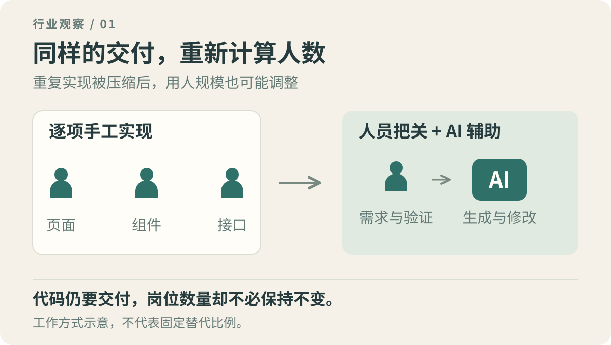
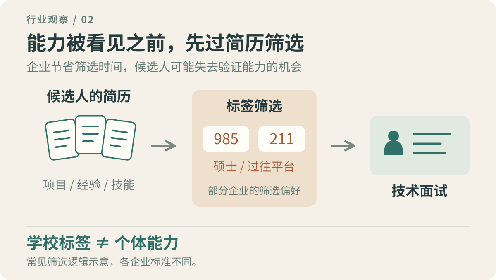
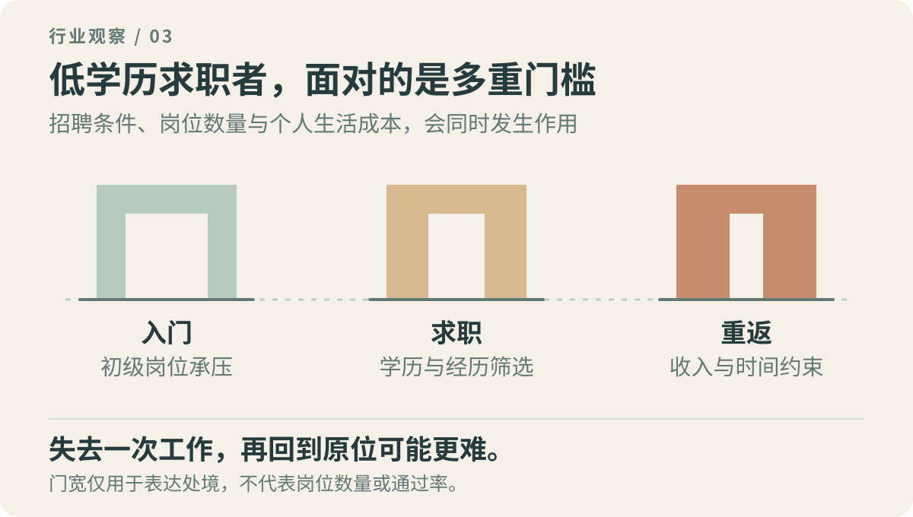

我是一名前端开发程序员。

**我已经一年时间没写过一行代码。**

把这两句话放在一起，多少有点荒诞。程序员这个职业，曾经最直观的工作内容就是写代码。如今再讨论它的前景，却越来越需要把“代码由谁写”和“公司雇多少人”分开来看。

一个人的经历不能代表整个行业。但当 AI 已经能够参与页面生成、组件开发和业务逻辑实现，过去靠熟练编码支撑起来的岗位，还能留下多少，确实值得怀疑。

我担心的，是大量普通程序员会陆续发现：原来的工作还在，企业却不再需要原来那么多人。

<!-- more -->

## 大多数业务开发，并没有那么特殊

谈到 AI 编程，总有人说，复杂业务做不了，架构设计做不了，历史系统也处理不好。

这些困难确实存在。问题在于，一个普通业务开发岗位，每天有多少时间在处理这些事情？

以前端为例，很多需求围绕着表单、表格、搜索、分页、弹窗、权限和接口展开。不同公司有不同规则，不同项目也有不同的历史包袱，但大量实现方式是相通的。

过去，熟悉框架、会用组件库、能独立完成联调，就足以承担一份工作。这些能力需要学习和练习，也曾经构成求职门槛。

现在，把需求、接口和项目约定交代清楚，AI 已经可以生成一部分实现。生成的结果需要检查，复杂交互需要调整，真实系统里的问题仍然需要人来处理。但重复编码所占用的时间，有了被压缩的可能。

企业是否减少岗位，不需要等到 AI 能独立完成一整套系统。只要某些工作能由更少的人完成，用人数量就有重新计算的空间。

“AI 还会犯错”，和“原来的人数仍然有必要”，之间并没有必然联系。

## 岗位减少，未必从裁员开始

企业用不用 AI，最终都要算成本。

模型费用、工具订阅、代码审查、安全和维护，都有成本。AI 生成代码也可能增加返工。只有把这些算进去以后，交付成本仍然下降，企业才有持续采用的理由。

一旦这种账算得过来，变化可能非常安静。

有人离职，不再补招；原本计划招聘的两个岗位，先取消一个；简单需求交给现有团队消化；原本需要外包的页面，内部借助工具完成。

在职的人未必立刻感受到冲击，正在找工作的人却会先遇到它：可投的岗位少了，要求更细了，面试流程更长了，薪资谈判的空间也更小了。

当然，不能把所有招聘收缩都归因于 AI。业务增长放缓、项目预算减少、外包调整，同样会影响岗位数量。AI 带来的新需求，也可能在一些领域增加就业。

但对依赖常规业务开发岗位的人来说，这几种变化可能同时发生：企业更谨慎地花钱，工具提高了部分工作的效率，求职者之间的竞争随之加重。

行业里仍然有人拿到高薪，并不能说明普通岗位的处境没有变化。

## 为什么招普通开发，也开始看 985、211 和硕士

招聘中让人感到门槛变化的，还有学历。

一些岗位做的仍然是常规业务，却会写上硕士学历、985、211 院校优先，或者在简历筛选中表现出类似偏好。岗位的日常内容，未必需要研究生阶段的学术训练。

这类要求的一种作用，是筛选。

一份简历，很难完整证明一个人的学习能力、自律程度和解决问题的水平。企业却需要在有限时间里，从大量候选人中挑出一部分进入面试。

于是，学历和学校就成了便于使用的标签。看到名校、硕士，人们容易默认：学习能力较强，能长期投入，接受新知识较快，完成任务的稳定性更高。

**这些是对群体标签的预期，不能直接证明某个具体人的能力。** 低学历的人也可能非常自律，技术扎实；高学历的人也可能不适合岗位。只是招聘筛选往往先于实际工作，个人能力还没被看见，简历就已经被分过一轮。

候选人充足时，企业更有条件使用这种粗糙的办法。它未必能找到所有合适的人，却能降低初步筛选的成本。

因此，学历门槛提高，有时反映的是企业拥有了更多选择，而非工作本身突然变难了。

## AI 降低了动手门槛，学历筛选却未必放松

表面上看，AI 让更多人有机会做出页面、写出程序，低学历求职者似乎也应该更容易进入行业。

但能完成一个作品，和能获得一个岗位，中间还有一整套招聘机制。

当基础实现越来越容易完成，一份普通项目作品所能证明的东西，也会发生变化。招聘方更难仅凭一个后台系统、一个商城页面，判断候选人到底理解多少，出了问题能不能独立处理。

技术面试当然可以继续验证，但面试需要人力和时间。企业如果先用学历、学校和过往公司缩小范围，低学历求职者甚至没有机会进入证明自己的环节。

过去，一部分人可以通过培训、自学、做项目，先进入行业，再用实际交付积累经验。这条路依赖一个前提：市场愿意提供足够多的入门岗位，让经验不足的人边工作边成长。

当常规实现可以更多地交给工具，企业又倾向于让少数熟悉业务的人把关时，初级岗位就可能承受压力。公司愿意招聘能够立即承担工作的人，愿意投入培养的名额却可能减少。

于是，低学历求职者遇到的困难会叠加：入门机会变少，筛选门槛提高，用来证明能力的作品又更容易被质疑。

“技术行业只看能力”，越来越需要补上一句：先有机会让别人看到你的能力。

## 学历不高的人，失去一次工作可能更难回来

对已经入行的人来说，学历问题也不一定随着工作年限消失。

在原来的公司，业务经验、合作关系和长期交付记录，可以让一个人的能力被具体地认识。离开以后，这些积累需要重新向陌生的招聘方证明。

如果新的岗位先卡学历、学校或过去的平台，那么一个有经验的开发者，也可能在技术面试之前被筛掉。

工作年限增长，还可能伴随着更高的薪资预期和家庭支出。企业筛选时会看成本，个人却未必有足够空间长期等待，或者接受明显低于过去的收入。

同样是失业，不同人的缓冲条件并不一样。有人能等待合适的机会，有人很快就必须接受降薪、转岗，或者离开原来的行业。

这也是为什么，讨论程序员的未来，不能只看最优秀的一小部分人。顶尖人才仍有机会，与大量普通开发者重新就业越来越困难，可以同时成立。

## 企业需要的代码，和企业提供的岗位

软件需求仍然存在，企业仍然需要系统、页面和各种业务功能。

但需求有多少，并不能直接换算成需要多少程序员。当工具改变了完成工作的方式，新增需求未必会带来同比例的新增岗位。

企业可以继续要求开发者懂业务、懂工程、会使用 AI，同时提高学历和经历门槛。留下的人承担更完整的工作，想进入的人面对更窄的入口，被挤出去的人则需要重新寻找收入来源。

我无法断言，最终会有多少程序员失业。但对普通业务开发者，尤其是学历不占优势的人来说，岗位收缩与筛选加码叠加在一起，意味着失去一次工作之后，再回到同样位置会更加困难。

代码仍然有人需要，个人也仍然可能具备完成工作的能力。只是市场提供的岗位，未必还容得下原来那么多人。
